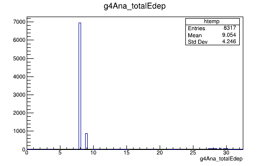
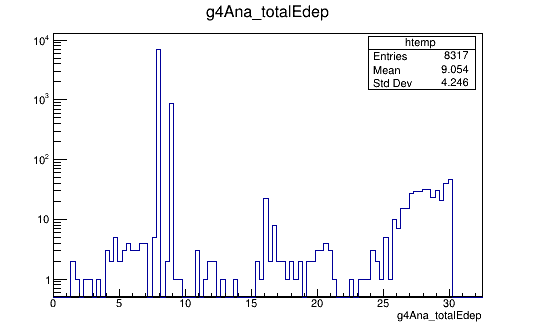

**Date:** 24/February/2021

**Author:** Javier Galan (javier.galan@unizar.es)

#### Detector geometry

This example implements a simple geometry composed by an empty `detector` cylinder surrounding the `target`, which is placed in the center.

#### Event generator
The event generator will launch electrons (`electron.yaml`) or gammas (`gamma.yaml`) in direction to the target. Hits will be registered at the `detector`.

#### Testing the example

Execute the following to launch gammas

```
restG4 gamma.yaml
```

or to launch electrons

```
restG4 electron.yaml
```

Then, generate few entries at the analysis tree by executing

```
restManager --c g4Analysis.yaml --i Output.root
```

where `Output.root` is the file generated by `restG4`.

Then open and explore the file using:

```
restRoot
[0] new TBrowser
```

#### Results

The execution of the example should produce the following fluorescences.




