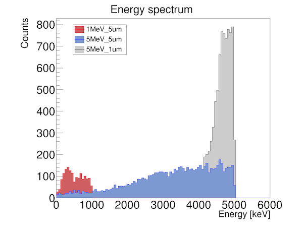
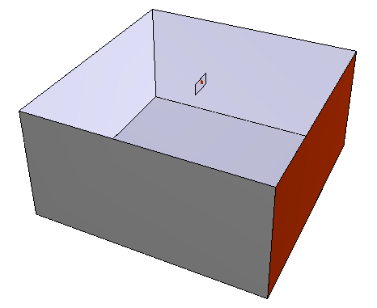
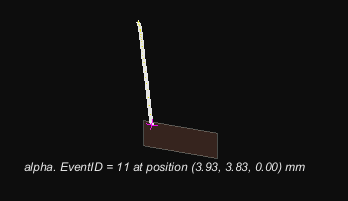

**Date:** 25/January/2022

**Author:** Javier Galan (javier.galan@unizar.es)

This example tests the generation of alphas with a well defined energy from a thin foil immersed in a gas volume.

#### Detector geometry

The geometry consists of a 10x10x10cm3 box made of Argon gas. In the middle of the box a small copper plate is placed. The thickness of the plate in um is the parameter `foil` of alphas.yaml (the constant `foil` of geometry/setup.gdml).

#### Event generator
The event generator will produce mono-energetic alphas produced in the copper sample volume (physical volume named source). The energy of the alphas in MeV is the parameter `energy` of alphas.yaml.

#### Testing the example

Create a "data" directory if not existing already

```
mkdir data
```

Execute the following to launch the generation of 10,000 alphas.

```
restG4 alphas.yaml
```

Execute the following to launch the processing of the generated events and produce few observables inside the analysis tree.

```
restManager --c analysis.yaml --i data/FileGenerated.root
```

See also the test of this example in `packages/restG4/test/src/examples.cxx` (ctest, BUILD_TESTING). The following plot showing the energy spectrum is generated with `plots.yaml`.




Commands to reproduce the figure shown follow:

```
mkdir data
restG4 alphas.yaml --set energy=5 --set foil=1
restG4 alphas.yaml --set energy=5 --set foil=5
restG4 alphas.yaml --set energy=1 --set foil=5

restManager --c analysis.yaml --i data/Run_1MeV_5um.root
restManager --c analysis.yaml --i data/Run_5MeV_1um.root
restManager --c analysis.yaml --i data/Run_5MeV_5um.root
restManager --c plots.yaml --i "data/Run_g4Analysis_*.root"
```


A minimal ROOT shell commands to visualize the detector geometry is:

```
restRoot
root [0] REST_Geant4_ViewGeometry("geometry/setup.gdml")
```

with the default values of the GDML; `restG4 alphas.yaml --set foil=1 --update-gdml` writes another value in
the GDML.



Minimal ROOT shell commands to visualize events

```
restRootMacros
root [0] REST_Geant4_ViewEvent("data/Run_5MeV_1um.root")
root [1] TGeoManager *geo = g->GetGeoManager("geometry/setup.gdml")
root [2] geo->GetTopVolume()->Draw("ogl")
```


