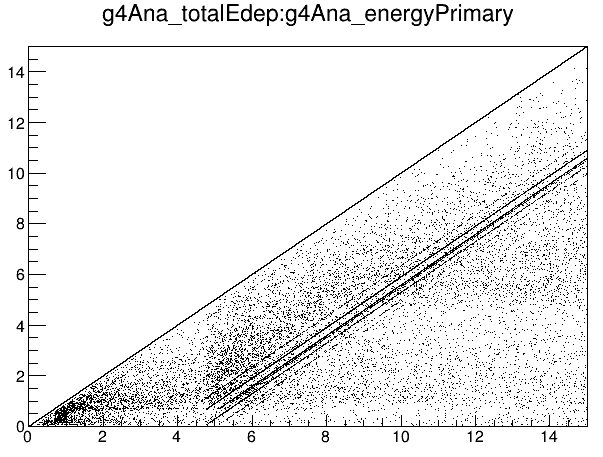

**Date:** 30/September/2022

**Author:** Javier Galan (javier.galan@unizar.es)

#### Detector geometry

This example implements a simple geometry composed by a `detector` box representing a gaseous TPC active volume. The detector has a squared shape of side `detectorSize` (mm), and a drift distance (defined on the z coordinate) of `drift` (mm): parameters of DetectorResponse.yaml and constants of geometry.gdml.

The geometry defines a gas mixture made of Neon and Xenon, the material (`gas`, a material of `materials.xml` with its mixture and pressure, e.g. `Xenon30%Neon1.5bar`) is also a parameter.

#### Event generator

The event generator will launch photons parallel to the z-axis towards the center of the detector. The energy of those photons will be homogeneously distributed between 0 and 15 keV.

#### Testing the example

Execute the following to generate a dataset.

```
restG4 DetectorResponse.yaml --set gas=Xenon30%Neon1.5bar --set drift=30 --set detectorSize=60
```

or simply use the bash script

```
bash launchResponse.sh
```

Then, populate the analysis tree by executing

```
restManager --c analysis.yaml --i Input.root --o Output.root
```

where `Input.root` is the file previously generated by `restG4`.

Then open and explore the file using:

```
restRoot Output.root
[0] new TBrowser
```

#### Results

The execution of the example should produce the following result for pure xenon.


